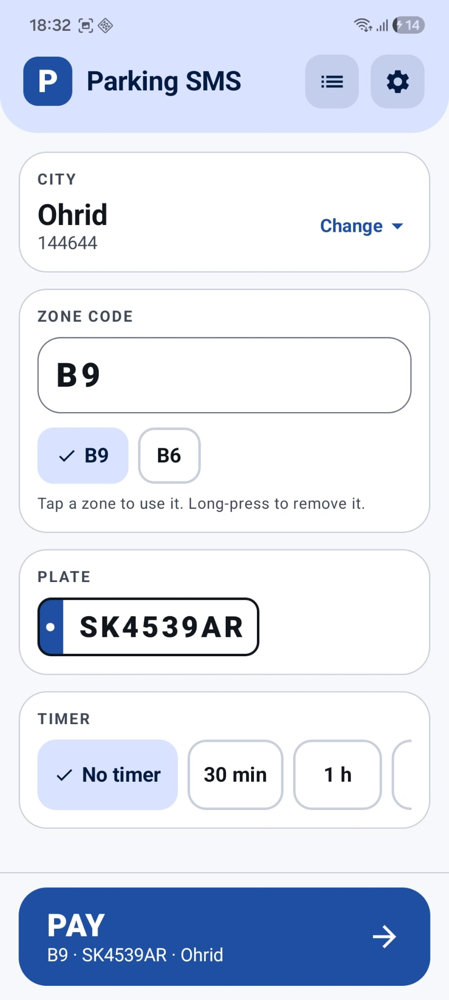
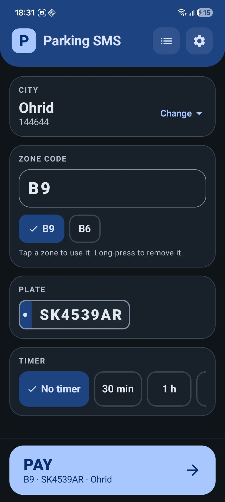
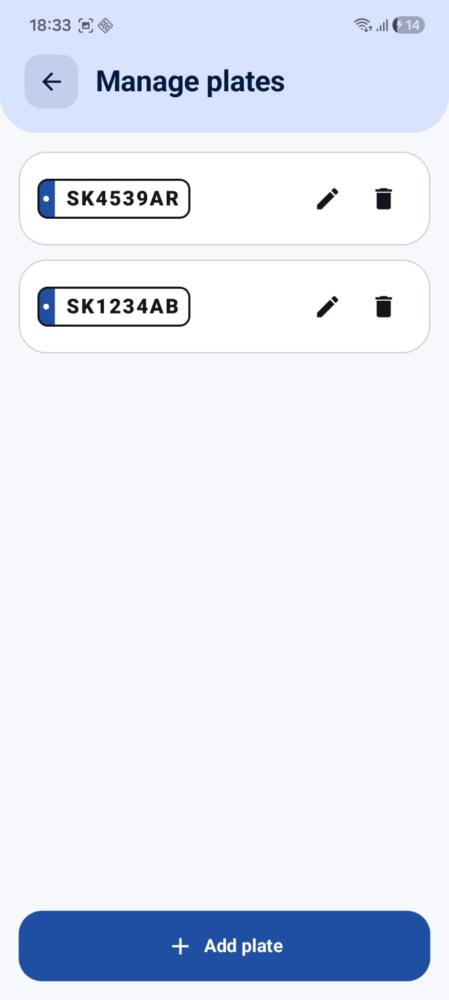
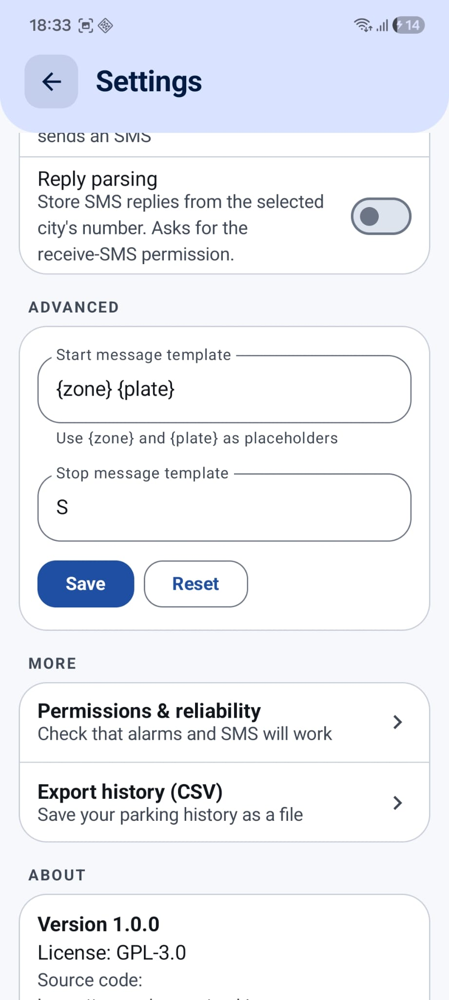
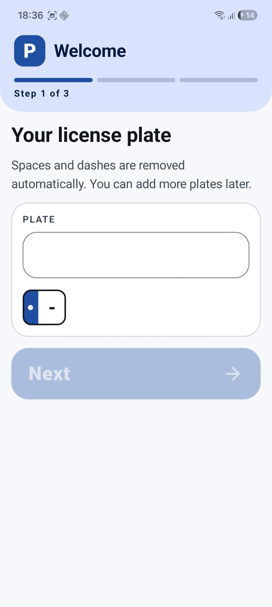
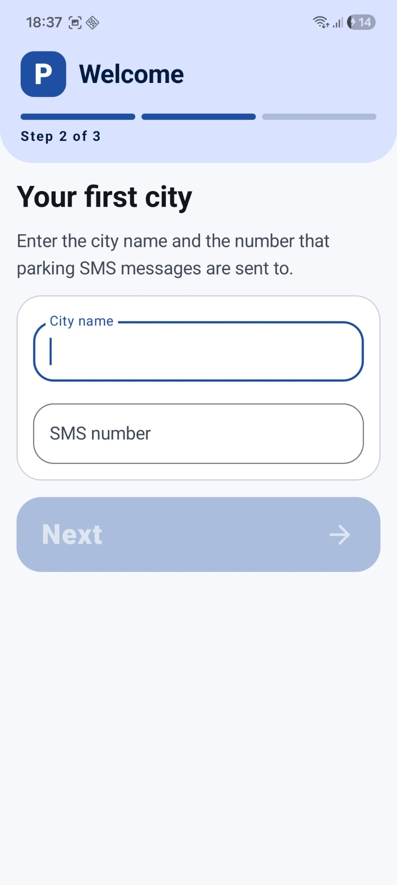

# Parking SMS

<p align="center">
  <a href="https://github.com/TomceGraphics/parking-sms/releases/latest/download/app-debug.apk">
    
  </a>
  <a href="https://api.obtainium.imranr.dev/redirect?r=https://github.com/TomceGraphics/parking-sms">
    
  </a>
</p>

<p align="center">
  <a href="https://github.com/TomceGraphics/parking-sms/releases/latest">
    
  </a>
  <a href="LICENSE">
    
  </a>
  
  
</p>

Pay for SMS parking, run a timer, and get an alarm-style alert so you never forget to stop.  
Native Android (Kotlin, Jetpack Compose, Material 3). Fully offline, no network permission,  
no Google Play Services, no analytics. License: **GPL-3.0** (see `LICENSE`).

## 1. What it does

In many towns you start parking by sending `<zone> <plate>` (for example `B9 BT1110AB`) to a
city number and stop it by sending `S` to the same number. It never stops by itself. This app:

- sends those SMS for you (start and stop), with templates you can edit,
- remembers cities (name + number), zone codes (automatically, only when you press Pay) and plates,
- cleans plates and zones live (`bt-1110 ab` becomes `BT1110AB`),
- runs a timer with three modes: **Alarm only**, **Auto-stop at end**, **Alarm, then auto-stop after a grace period**,
- optional reminder N minutes before the end,
- rings a full-screen alarm over the lock screen (STOP PARKING / SNOOZE),
- shows an ongoing notification with a Stop button, survives reboots (the session lives in a database),
- retries a failed SMS once, and never fails silently (a failed Stop keeps ringing with a Retry button),
- has a home-screen widget (Glance) and a Quick Settings tile,
- history with CSV export, Test mode (never sends SMS), optional reply logging.

## Screenshots

<p align="center">
  
  
  
</p>
<p align="center">
  
  
  
</p>

## 2. Prerequisites (no Android Studio needed)

You need **JDK 17** and the **Android command-line tools**.

### Windows
1. Install JDK 17, e.g. from https://adoptium.net (choose "Temurin 17", tick "Set JAVA_HOME").
2. Download "Command line tools only" from https://developer.android.com/studio#command-line-tools-only
3. Create the folder `C:\Android\cmdline-tools\latest` and unzip the contents of the zip *into* `latest`
   (so that `C:\Android\cmdline-tools\latest\bin\sdkmanager.bat` exists).
4. Set environment variables (Start menu > "Edit environment variables"):
   `ANDROID_HOME=C:\Android` and add `%ANDROID_HOME%\cmdline-tools\latest\bin` and `%ANDROID_HOME%\platform-tools` to `Path`.
5. Open a NEW terminal and run:
   ```
   sdkmanager "platforms;android-34" "build-tools;34.0.0" "platform-tools"
   sdkmanager --licenses
   ```

### macOS
```
brew install openjdk@17
# follow brew's hint to link it, or: export JAVA_HOME=$(/usr/libexec/java_home -v 17)
mkdir -p ~/Android/cmdline-tools
# unzip the command line tools zip, then move the folder to ~/Android/cmdline-tools/latest
export ANDROID_HOME=$HOME/Android
export PATH=$PATH:$ANDROID_HOME/cmdline-tools/latest/bin:$ANDROID_HOME/platform-tools
sdkmanager "platforms;android-34" "build-tools;34.0.0" "platform-tools"
sdkmanager --licenses
```
Add the two `export` lines to `~/.zshrc` to make them permanent.

### Linux
```
sudo apt install openjdk-17-jdk unzip      # Debian/Ubuntu; on Fedora: sudo dnf install java-17-openjdk-devel
mkdir -p ~/Android/cmdline-tools
unzip commandlinetools-linux-*.zip -d ~/Android/cmdline-tools
mv ~/Android/cmdline-tools/cmdline-tools ~/Android/cmdline-tools/latest
export ANDROID_HOME=$HOME/Android
export PATH=$PATH:$ANDROID_HOME/cmdline-tools/latest/bin:$ANDROID_HOME/platform-tools
sdkmanager "platforms;android-34" "build-tools;34.0.0" "platform-tools"
sdkmanager --licenses
```
Add the `export` lines to `~/.bashrc` to keep them.

Optionally create `local.properties` in the project root: `sdk.dir=/path/to/Android` (use `C\:\\Android` on Windows).

## 3. Gradle wrapper

This zip already contains `gradlew`, `gradlew.bat`, `gradle/wrapper/gradle-wrapper.jar` and
`gradle-wrapper.properties` (Gradle 8.7). If the jar is missing or damaged, install Gradle once
(https://gradle.org/install) and run in the project root:
```
gradle wrapper --gradle-version 8.7
```
On Linux/macOS also run `chmod +x gradlew` if needed.

## 4. Build

```
./gradlew assembleDebug          # Windows: gradlew.bat assembleDebug
```
The first build downloads dependencies (needs internet, a few minutes).
Result: `app/build/outputs/apk/debug/app-debug.apk` (signed automatically with the debug keystore).
Run unit tests with `./gradlew testDebugUnitTest`.

## 5. Install on the phone

**With adb (USB):** enable Developer options > USB debugging on the phone, connect it, then
`adb devices` (accept the prompt on the phone) and
```
adb install -r app/build/outputs/apk/debug/app-debug.apk
```
**With adb (wireless, Android 11+):** Developer options > Wireless debugging > Pair device with pairing code, then
`adb pair <ip>:<pairing-port>`, `adb connect <ip>:<port>`, and run the same `adb install`.

**Without adb:** copy `app-debug.apk` to the phone (USB cable, cloud, messenger), open it in a file
manager and allow "Install unknown apps" for that file manager when asked.

## 6. Galaxy A53 / Android 13+ first-run checklist

Open **Settings > Permissions & reliability** inside the app; it shows live status of each item.

1. **Allow restricted settings** (apps installed outside a store): Settings > Apps > Parking SMS >
   three-dot menu (top right) > *Allow restricted settings*. Do this BEFORE the SMS permission if it is greyed out.
2. **SMS permission**: allow "Send SMS".
3. **Notifications**: allow (Android 13+).
4. **Alarms & reminders**: allow exact alarms (Settings > Apps > Parking SMS > Alarms & reminders).
5. **Full-screen notifications**: allow (needed on Android 14 so the alarm can take over the screen).
6. **Battery**: Settings > Apps > Parking SMS > Battery > **Unrestricted**.
7. **Sleeping apps**: Settings > Battery > Background usage limits: make sure Parking SMS is NOT in
   *Sleeping apps* or *Deep sleeping apps* (remove it, and turn off "Put unused apps to sleep" if it keeps coming back).
8. Dual SIM: the app uses the phone's default SMS SIM (Settings > Connections > SIM manager > Text messages).

## 7. Widget and Quick Settings tile

- **Widget:** long-press the home screen > Widgets > Parking SMS > drag it out. Idle it shows your last
  city, zone and plate with a Pay button; while parking it shows a running timer and a Stop button.
  Pay once from the app first so the widget knows your last zone.
- **Tile:** swipe down twice to open Quick Settings > pencil (edit) icon > drag "Pay parking" into the
  active tiles. Idle = Pay, active = Stop.

## 8. Test mode

Settings > Behavior > **Test mode**. Nothing is sent: the app only logs the text it would send
(see "SMS log" in History details and Logcat tag `ParkingSms`). A "TEST MODE" banner is shown on the
dashboard. Try timers, alarms, snooze, widget and tile safely, then turn it off.

## 9. Editing the code (VS Code or Zed)

- **VS Code:** extensions "Kotlin" (fwcd.kotlin) or "Kotlin Language", "Gradle for Java", "XML".
- **Zed:** install the "Kotlin" extension (uses kotlin-language-server). Opening the project folder is enough.
- Compose previews are not available outside Android Studio; run on the phone with `adb install`.

Common build errors:

| Error | Fix |
|---|---|
| `SDK location not found` | Set `ANDROID_HOME` or create `local.properties` with `sdk.dir=...` |
| `Failed to install the following Android SDK packages ... licenses` | Run `sdkmanager --licenses` and accept all |
| `Unsupported class file major version` / wrong Java | Use JDK 17: check `java -version` and `JAVA_HOME` |
| `Permission denied: ./gradlew` | `chmod +x gradlew` |
| Out of memory | Raise `org.gradle.jvmargs` in `gradle.properties` |
| Could not resolve dependency | Check internet/proxy; retry; `./gradlew --refresh-dependencies assembleDebug` |
| `INSTALL_FAILED_UPDATE_INCOMPATIBLE` | Uninstall the old app (different signing key) and install again |

## 10. Project structure

```
app/src/main/java/app/parkingsms/
  ParkingApp.kt            Application + AppContainer (manual DI)
  MainActivity.kt
  data/                    Room entities/DAOs/database, repository, DataStore settings
  sms/                     SmsSender interface, Android/Test/Switching senders, reply receiver
  session/                 SessionManager (all start/stop logic), alarms, notifications, quick actions
  receiver/                AlarmReceiver, BootReceiver, ActionReceiver
  widget/                  Glance home-screen widget
  tile/                    Quick Settings tile
  ui/                      Compose screens (dashboard, onboarding, settings, history, permissions, alarm)
  ui/Design.kt             Design system: header panel, panel cards, plate badge, timer ring, big buttons
  ui/theme/Theme.kt        Colors (60/30/10), typography, shapes
  util/                    TextCleaner, MessageTemplate, TimerMath, CSV export
app/src/test/              Unit tests (cleaning, templates, timer math, SessionManager with fakes)
```
Design notes: one `SessionManager` owns start/stop; UI, notification actions, widget, tile and alarm
receivers all call it. The active session and its next alarm are stored in Room, so alarms are re-armed
after reboot and app update. Extension point for a future car-Bluetooth feature is documented in
`SessionManager.kt` (`Plate.carBluetoothAddress` is reserved, unused).

## 11. Publishing

- **GitHub Releases + Obtainium (easiest):** push the source to GitHub, build a signed release APK
  (below), attach it to a Release. Users add the repo URL in Obtainium and get updates.
- **IzzyOnDroid:** a third-party F-Droid-compatible repo; open an inclusion request at its GitLab,
  pointing to your GitHub releases. Requires FOSS-only dependencies (this project qualifies).
- **F-Droid:** requires a public source repository, only FOSS dependencies (true here; no Google
  services, no proprietary blobs; `dependenciesInfo` is disabled), and a metadata file submitted as a
  merge request to `fdroiddata`. F-Droid builds from source; keep `versionCode`/`versionName` updated
  and tag releases.
- **Release signing:** create a keystore once and keep it safe (losing it means users can't update):
  ```
  keytool -genkeypair -v -keystore parking-sms-release.jks -alias parkingsms -keyalg RSA -keysize 4096 -validity 10000
  ```
  Create `keystore.properties` in the project root (it is git-ignored):
  ```
  storeFile=/absolute/path/parking-sms-release.jks
  storePassword=...
  keyAlias=parkingsms
  keyPassword=...
  ```
  then `./gradlew assembleRelease` > `app/build/outputs/apk/release/app-release.apk`.
  Release builds enable R8 minification; if something breaks only in release, set `isMinifyEnabled = false`
  in `app/build.gradle.kts` and extend `proguard-rules.pro`.
- **Play Store:** a poor fit. Google Play restricts SMS permissions to default SMS/phone/assistant apps, so
  an app like this would almost certainly be rejected.

## 12. Troubleshooting

- **SMS not sending:** check the SMS permission (and "Allow restricted settings"), mobile service/airplane mode,
  the correct default SMS SIM, and the number. Look at History > details > SMS log. Test mode must be OFF.
  Some carriers block SMS to short codes from a SIM without balance.
- **Alarm not firing / late:** grant exact alarms, full-screen alerts, notifications; set battery to Unrestricted;
  remove the app from Sleeping apps. Without exact-alarm permission the app falls back to an inexact alarm and
  shows a warning on the dashboard.
- **Alarm silent:** the sound uses the alarm volume and the default alarm ringtone; check the alarm volume and that
  the "Parking alarm" notification channel is not muted (Settings > Apps > Parking SMS > Notifications).
- **Widget not updating:** remove and re-add it; open the app once and pay so a last zone exists. The running timer
  is a live chronometer; other text refreshes when a session starts or stops.
- **Tile missing:** add it through the Quick Settings edit screen (see section 7).
- **Stop button in the notification does nothing on the lock screen:** some lock-screen settings require unlocking
  first; use the full-screen alarm or unlock the phone.

## 13. License

GPL-3.0-or-later. See `LICENSE`. Source repository: https://github.com/TomceGraphics/parking-sms
