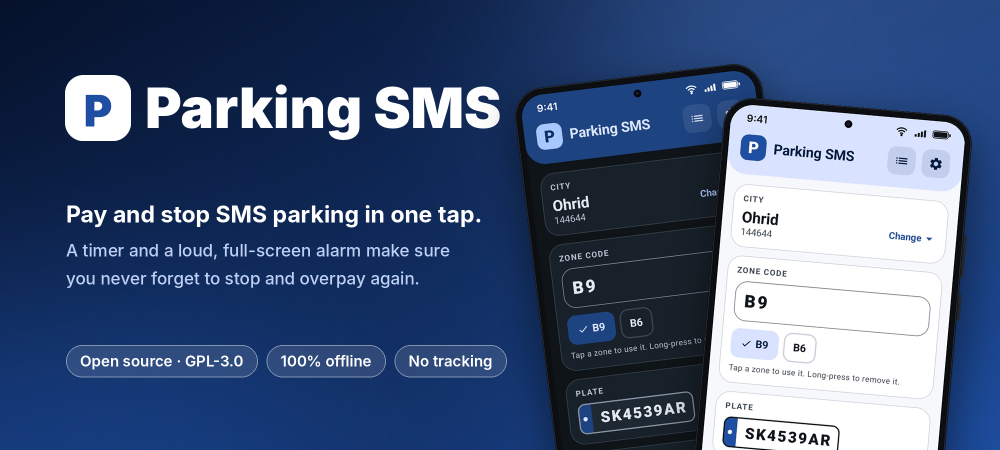
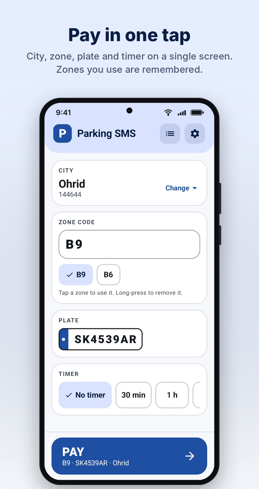
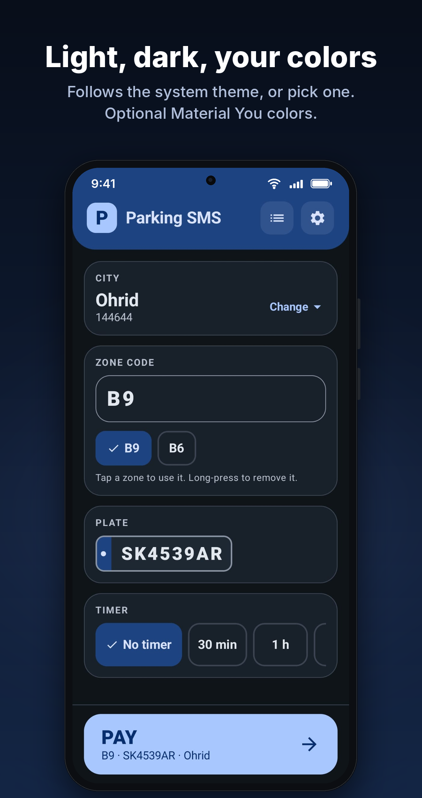
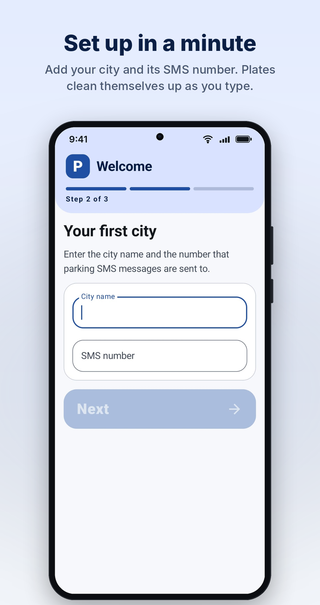
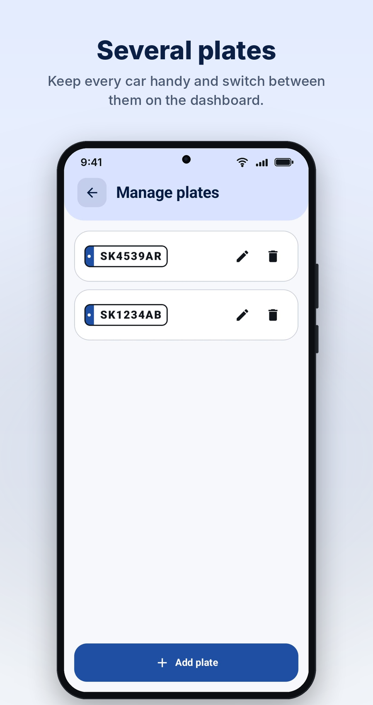
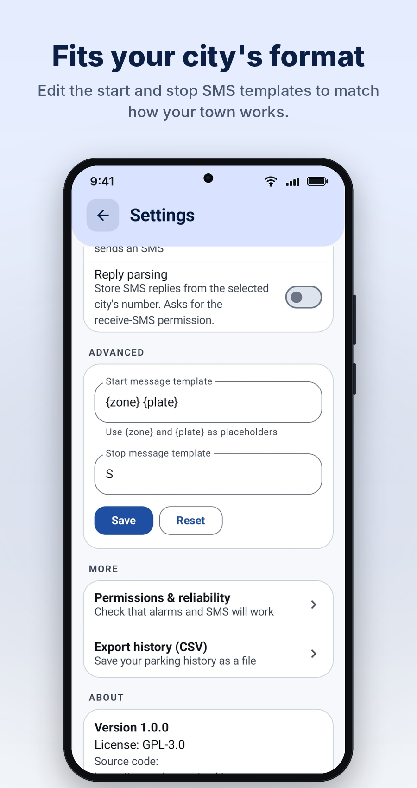

<p align="center">
  
</p>

<p align="center">
  <a href="https://github.com/TomceGraphics/parking-sms/releases/latest/download/app-debug.apk">
    
  </a>
  <a href="https://api.obtainium.imranr.dev/redirect?r=https://github.com/TomceGraphics/parking-sms">
    
  </a>
</p>

<p align="center">
  <a href="https://github.com/TomceGraphics/parking-sms/releases/latest"></a>
  <a href="LICENSE"></a>
  
  
  
  
</p>

# Parking SMS

**Pay and stop SMS parking in one tap, with a timer and a full-screen alarm so you never forget to stop.**

In many towns you start parking by texting `<zone> <plate>` to a city number, for example `B9 SK4539AR`, and stop it by texting `S` to the same number. Nothing stops automatically, so one forgotten stop means an expensive afternoon. Parking SMS sends those messages for you, runs the timer, and keeps ringing until you deal with it.

It is a small, fully offline, open-source Android app: no accounts, no tracking, no network permission.

## Screenshots

<table>
  <tr>
    <td width="50%"></td>
    <td width="50%"></td>
  </tr>
</table>
<table>
  <tr>
    <td width="33%"></td>
    <td width="33%"></td>
    <td width="33%"></td>
  </tr>
</table>

## Features

**Paying and stopping**
- One screen: city, zone code, plate and timer, then a big **Pay** button within thumb reach.
- Zone codes are remembered per city and shown as chips. Tap to reuse, long-press to remove.
- Plates and zones are cleaned live: `bt-1110 ab` becomes `BT1110AB`.
- Start and stop message templates are editable, so it works with your town's format.
- A failed SMS is retried once. If a **Stop** still fails, the alarm keeps ringing with a Retry button. It never fails silently.

**Timer and alarm**
- Choose No timer, 30 min, 1 h, 2 h or a custom length.
- Three modes: **Alarm only**, **Auto-stop at the end**, or **Alarm, then auto-stop after a grace period**.
- Optional reminder a few minutes before the end, plus snooze.
- A loud full-screen alarm over the lock screen with big **Stop parking** and **Snooze** buttons.
- An ongoing notification with a Stop action. Alarms and the running session survive reboots.

**Everywhere you need it**
- Home-screen widget (Pay when idle, live timer and Stop when parking).
- Quick Settings tile.
- History of every session, with a CSV export.

**Safe to try**
- **Test mode** logs the message it would send and never touches the SMS system.
- Light, dark or system theme, and optional Material You colors.

## Install

<p align="center">
  <a href="https://github.com/TomceGraphics/parking-sms/releases/latest/download/app-debug.apk">
    
  </a>
  <a href="https://api.obtainium.imranr.dev/redirect?r=https://github.com/TomceGraphics/parking-sms">
    
  </a>
</p>

**Obtainium (recommended).** Add this repository's URL in [Obtainium](https://github.com/ImranR98/Obtainium) and it will follow new releases.

**APK.** Download the latest APK from the repository's [Releases](https://github.com/TomceGraphics/parking-sms/releases/latest) page (or via the direct download button above) and open it on your phone.

**From source.** See [docs/BUILDING.md](docs/BUILDING.md) for a step-by-step guide for Linux, macOS and Windows. You only need JDK 17 and the Android command-line tools, not Android Studio.

```bash
./gradlew assembleDebug     # APK: app/build/outputs/apk/debug/app-debug.apk
./gradlew installDebug      # build and install on a connected phone
./gradlew testDebugUnitTest # unit tests
```

## First-run checklist

Open **Settings > Permissions & reliability**. It shows the live status of everything below.

1. **Allow restricted settings** (apps installed outside a store, Android 13+): App info > three-dot menu > *Allow restricted settings*. Do this first if the SMS permission is greyed out.
2. Allow **Send SMS** and **Notifications**.
3. Allow **exact alarms** and **full-screen notifications**.
4. Set **Battery** to **Unrestricted** for the app.
5. On Samsung phones, make sure the app is not in *Sleeping apps* or *Deep sleeping apps*.

Try everything once in **Test mode** before using it for real. The app picks the default SMS SIM on dual-SIM phones.

## Privacy and permissions

Everything stays on your device. There are no accounts, analytics, ads or network calls, and the app declares **no `INTERNET` permission**.

| Permission | Why |
|---|---|
| `SEND_SMS` | Send the start and stop messages |
| `RECEIVE_SMS` | Only requested if you turn on *Reply parsing*, to store the city's reply |
| `POST_NOTIFICATIONS` | Session notification and alarm |
| `SCHEDULE_EXACT_ALARM` | Fire the timer on time, even in Doze |
| `USE_FULL_SCREEN_INTENT` | Show the alarm over the lock screen |
| `RECEIVE_BOOT_COMPLETED` | Re-arm the alarm for a running session after a reboot |
| `VIBRATE` | Alarm vibration |

## How it is built

Kotlin, Jetpack Compose (Material 3), Room, DataStore and Glance (widget). No Hilt, no Google Play Services, no proprietary libraries, so it is F-Droid compatible.

- `SessionManager` owns all start/stop/alarm logic. The UI, notification actions, widget, tile and alarm receivers all call into it.
- The active session and its next alarm are stored in the database, never only in memory, so a killed process or a reboot cannot lose a running session.
- SMS sending sits behind an interface, which is what makes Test mode and the unit tests possible.
- The design system (header panel, plate badge, timer ring, big buttons) lives in `ui/Design.kt`, and colors and typography in `ui/theme/Theme.kt`.

```
app/src/main/java/app/parkingsms/
  data/       Room, repository, DataStore settings
  session/    SessionManager, alarms, notifications, quick actions
  sms/        SMS sender interface and implementations
  receiver/   alarm, boot and notification-action receivers
  widget/     Glance home-screen widget
  tile/       Quick Settings tile
  ui/         Compose screens and design system
  util/       plate/zone cleaning, templates, timer math, CSV
```

## Roadmap

- Auto-stop or a reminder when your phone disconnects from the car's Bluetooth (the extension point is already marked in `SessionManager`)
- Interpreting the city's SMS replies
- Translations
- More widget layouts

## Good to know

Standard SMS rates from your carrier apply. Parking SMS is not affiliated with any city or parking operator, and you remain responsible for your parking fees: check that your own start and stop messages are correct, and use Test mode first. Alarm reliability also depends on how aggressively a phone maker limits background apps, which is why the checklist above matters.

## Contributing

Issues and pull requests are welcome, especially message formats and zone conventions for other towns. Run `./gradlew testDebugUnitTest` before opening a PR. To regenerate the README images from your own screenshots, drop them in `docs/raw/` and run `python3 tools/frame_screenshots.py` (needs `pillow` and `numpy`).

## License

GPL-3.0. See [LICENSE](LICENSE).
